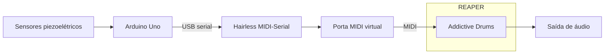
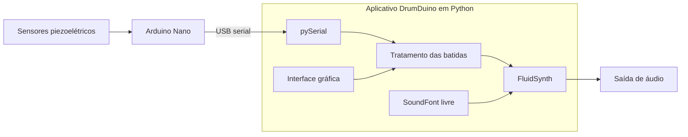

# DrumDuino

**Projeto de bateria eletrônica com Arduino**


Universidade Federal do ABC - Bacharelado em Ciência e Tecnologia<br />
Disciplina e quadrimestre a confirmar

Lenin Cristi<br />
lenin.cristi@aluno.ufabc.edu.br

## Resumo

O **DrumDuino** é um projeto didático de bateria eletrônica baseado no Arduino Nano (ATmega328) ou Arduino Uno R3, firmware em **C++** e organização pelo **PlatformIO**, a ponte serial é feita via **USB** com **pySerial** e sintetizada pelo **FluidSynth** no computador.

> **Status Atual** O firmware lê um sensor piezoelétrico na entrada A0 e, ao detectar uma leitura igual ou superior ao limiar, acende brevemente o LED integrado e informa a leitura pelo monitor serial.

## Estrutura do projeto

```text
.
├── assets/                     # Identidade visual
├── src/
│   ├── main_v00_base.cpp       # Exemplo inicial
│   ├── main_v01_blink.cpp      # Teste do LED integrado
│   └── main_v02_piezo.cpp      # Teste de um sensor piezoelétrico
├── include/                    # Diretório reservado para cabeçalhos
├── lib/                        # Diretório reservado para bibliotecas
├── test/                       # Diretório reservado para testes
├── .vscode/                    # Configurações do editor
├── platformio.ini              # Ambientes e seleção dos fontes
├── .gitignore
└── LICENSE                     # Licença MIT
```

Para permitir entender a evolução do código, cada versão é mantida em um arquivo separado, facilitando a comparação e o aprendizado. Isso é feito através da utilização de diferentes arquivos para cada etapa do projeto, o PlatformIO chama isso de **ambientes**.

### Ambientes PlatformIO disponíveis

Cada *versão* ou *ambiente* do código possui seu próprio `setup()` e `loop()`. A configuração em `platformio.ini` define o ambiente atual em uso, que também determina qual arquivo será compilado e executado na placa. Abra o arquivo `platformio.ini` para alterar o ambiente ativo:

```ini
[platformio]
default_envs = piezo
```

| Ambiente | Arquivo selecionado | Comportamento |
|---|---|---|
| `base` | `main_v00_base.cpp` | Exemplo inicial, sem saída visível |
| `blink` | `main_v01_blink.cpp` | LED aceso por 500 ms e apagado por 500 ms |
| `piezo` (padrão) | `main_v02_piezo.cpp` | Detecção de batidas, LED e mensagens na serial |

## Ambiente de desenvolvimento do projeto

São necessárias algumas ferramentas para abrir o código, compilá-lo (transformá-lo em um programa para a placa que chamamos de **firmware**), gravá-lo na placa e usar de fato o projeto como uma bateria virtual.

### Software necessário

| Software | Para que serve | Onde obter |
|---|---|---|
| [Git](https://git-scm.com/) | Copiar o repositório e acompanhar as versões dos arquivos | [Instalar o Git](https://git-scm.com/downloads) |
| [Visual Studio Code (VS Code)](https://code.visualstudio.com/) | Editor disponível para Windows, Linux e macOS | [Baixar o VS Code](https://code.visualstudio.com/download) |
| [Extensão PlatformIO IDE](https://platformio.org/platformio-ide) | Acrescenta ao editor as ferramentas de compilação, gravação e monitor serial | [Guia de instalação](https://docs.platformio.org/en/latest/integration/ide/vscode.html) |
| [uv](https://docs.astral.sh/uv/) | Gerenciar Python, ambientes isolados e dependências do aplicativo de áudio | [Instalar o uv](https://docs.astral.sh/uv/getting-started/installation/) |
| [Python](https://www.python.org/) | Linguagem usada no aplicativo de áudio | [Instalar pelo uv](https://docs.astral.sh/uv/guides/install-python/) |
| [FluidSynth](https://www.fluidsynth.org/) | Biblioteca nativa que gera áudio a partir de uma SoundFont | [Downloads e instalação](https://www.fluidsynth.org/download/) |

O **Git** copia o projeto para o computador. O **VS Code** é o editor onde trabalhamos, a extensão **PlatformIO** acrescenta a ele os comandos para compilar e gravar o programa no Arduino. Para o áudio no computador, o **uv** gerencia o Python e suas bibliotecas, enquanto o **FluidSynth** produz o som.

O teste do projeto pelo monitor serial usa Git, VS Code e PlatformIO. Python, uv e FluidSynth pertencem à proposta de áudio. Não é necessário instalar o Arduino IDE separadamente. Tenha acesso à internet durante a instalação e a primeira compilação.

### Instalar o Git

#### Windows

Baixe o instalador na [página oficial do Git para Windows](https://git-scm.com/install/windows), execute-o e siga as instruções. Depois, abra novamente o terminal ou o VS Code para reconhecer a instalação.

#### Linux (Ubuntu)

Abra o **Terminal** e execute um comando por vez:

```sh
sudo apt update
sudo apt install git
```

O `sudo` permite instalar programas e pode solicitar sua senha. Referência: [instalação do Git no Linux](https://git-scm.com/install/linux).

Nos dois sistemas, confira a instalação em um terminal:

```sh
git --version
```

### Instalar o VS Code

#### Windows

Baixe o instalador em [Download do VS Code](https://code.visualstudio.com/download), escolha a opção para Windows e siga o assistente.

Referência: [Guia oficial para Windows](https://code.visualstudio.com/docs/setup/windows).

#### Linux (Ubuntu)

Baixe o pacote **.deb** em [Download do VS Code](https://code.visualstudio.com/download), de acordo com a arquitetura do computador. Abra um terminal na pasta do download e instale o arquivo:

```sh
sudo apt install ./nome-do-arquivo.deb
```

Substitua `nome-do-arquivo.deb` pelo nome do pacote baixado.

Referência: [Guia oficial para Linux/Ubuntu](https://code.visualstudio.com/docs/setup/linux).

### Instalar a extensão PlatformIO IDE

1. No VS Code, clique em **Extensions / Extensões**, na barra lateral (ícone de blocos).
2. Pesquise **PlatformIO IDE** e escolha a extensão publicada por **PlatformIO**.
3. Clique em **Install / Instalar** e aguarde a preparação do ambiente.
4. Reinicie ou recarregue o VS Code se solicitado.
A extensão é instalada da mesma forma no Windows e no Ubuntu. Os comandos específicos do projeto aparecem depois que você abre a pasta do repositório.

### Preparar o ambiente Python com o uv

O **uv** instala o **Python** e gerencia as bibliotecas do aplicativo em ambientes separados de outros projetos.

Referência: [Guia oficial de instalação do uv](https://docs.astral.sh/uv/getting-started/installation/).

#### Windows

Abra o Terminal do Windows ou PowerShell e, se o WinGet estiver disponível, execute:

```powershell
winget install --id=astral-sh.uv -e
```

Se não tiver WinGet, use uma das alternativas do guia oficial.

#### Linux (Ubuntu)

No Terminal, instale o `curl`, usado para baixar o instalador oficial, e execute:

```sh
sudo apt update
sudo apt install curl
curl -LsSf https://astral.sh/uv/install.sh | sh
```

#### Conferir a instalação e instalar Python

Nos dois sistemas, feche e abra novamente o terminal e execute:

```sh
uv --version
uv python install
```

O segundo comando instala Python pelo uv, sem precisar de um instalador separado. A versão de Python e as dependências do aplicativo devem ser definidas na configuração do componente de áudio; esses comandos apenas preparam as ferramentas.

Veja o [Guia de Python com uv](https://docs.astral.sh/uv/guides/install-python/).

### Preparar FluidSynth

O **FluidSynth** é o motor de áudio. Ele é instalado separadamente das bibliotecas **Python**; instalar apenas uma biblioteca de integração Python não instala necessariamente esse motor.

Referência: [Guia oficial de download do FluidSynth](https://www.fluidsynth.org/download/).

#### Windows

1. Na página oficial, siga o link dos binários para Windows nas versões do GitHub.
2. Baixe um pacote com a mesma arquitetura do Python, por exemplo, ambos de 64 bits.
3. Extraia o pacote em uma pasta permanente. A biblioteca e suas dependências precisam ficar acessíveis ao aplicativo Python.
4. Para conferir o executável, abra o PowerShell na pasta que contém `fluidsynth.exe` e execute:

   ```powershell
   .\fluidsynth.exe --version
   ```

#### Linux (Ubuntu)

Instale o executável e a biblioteca pelo gerenciador de pacotes:

```sh
sudo apt update
sudo apt install fluidsynth libfluidsynth3
fluidsynth --version
```

O comando de versão verifica o executável; a integração da biblioteca com Python é uma verificação separada.

Para gerar som, o FluidSynth também precisa de uma **SoundFont**, arquivo que contém os sons dos instrumentos. O banco escolhido deve ter licença livre e origem documentadas.

A [introdução oficial](https://www.fluidsynth.org/wiki/GettingStarted/) explica esses arquivos. Nenhuma SoundFont está incluída neste repositório.

### Copiar o projeto do GitHub

O **GitHub** é um serviço que hospeda projetos e permite compartilhar arquivos e seu histórico de alterações. Um **repositório** é o conjunto desses arquivos. **Clonar** significa criar uma cópia do repositório no seu computador usando o Git.

O repositório deste projeto é [lnncrs/DrumDuino](https://github.com/lnncrs/DrumDuino).

Para cloná-lo pelo VS Code:

1. No menu **View / Exibir**, abra **Command Palette / Paleta de Comandos**.
2. Procure e selecione **Git: Clone**.
3. Cole `https://github.com/lnncrs/DrumDuino.git` e confirme.
4. Escolha uma pasta para guardar o projeto.
5. Ao terminar, clique em **Open / Abrir**. Se houver uma pergunta sobre confiança nos autores, revise a origem e os arquivos antes de autorizar a execução das ferramentas.

Como alternativa, abra um terminal na pasta em que deseja copiar o projeto e execute:

```sh
git clone https://github.com/lnncrs/DrumDuino.git
```

Depois, no VS Code use **File > Open Folder / Arquivo > Abrir Pasta** e selecione a pasta `DrumDuino` criada pelo comando.

### Reconhecer a placa e a configuração

Abra no **VS Code** a pasta do projeto (a que contém `platformio.ini`). No ícone do PlatformIO, abra **Project Tasks** para encontrar as tarefas dos ambientes `base`, `blink` e `piezo`.

O arquivo `platformio.ini` define a plataforma `atmelavr`, a placa `nanoatmega328`, o framework `arduino` e o monitor serial em **9600 baud**. O identificador `nanoatmega328` é a placa; `piezo` é o ambiente padrão do teste.

#### Windows

> Este processo é automático na maioria dos casos usando o **PlatformIO**.

Conecte o Nano com um cabo USB de dados e procure sua porta COM no **Gerenciador de Dispositivos**, em **Portas (COM e LPT)**. Se a placa não for reconhecida, confira o cabo e o driver do conversor USB-serial, conforme o fabricante da placa.

#### Linux (Ubuntu)

> Este processo é automático na maioria dos casos usando o **PlatformIO**.

Conecte o Nano com um cabo USB de dados. Se a porta não aparecer ou houver erro de permissão, siga o [guia de regras e permissões USB do PlatformIO](https://docs.platformio.org/en/latest/core/installation/udev-rules.html). No Ubuntu, o acesso à porta também pode exigir que seu usuário pertença ao grupo `dialout`, conforme a orientação desse guia.

## Hardware usado no projeto

### Arduino

Arduino é uma plataforma de desenvolvimento eletrônico. Suas placas possuem um **microcontrolador**, em outras palavras um pequeno computador que executa o programa ou **firmware** e interage com os sensores pelos pinos de conexão.

As placas consideradas neste projeto são o **Nano** e o **Uno R3**, ambos baseados no ATmega328P. Os links abaixo incluem fotos e desenhos dos pinos para identificar cada modelo.

| Placa | Características | Uso no projeto |
|---|---|---|
| [Arduino Nano clássico - fotos e documentação](https://docs.arduino.cc/hardware/nano/) | Compacto, adequado à protoboard, com entradas analógicas e USB | Placa usada na montagem e configurada no `platformio.ini` |
| [Arduino Uno R3 - fotos e documentação](https://docs.arduino.cc/hardware/uno-rev3/) | Maior, com conectores que facilitam montagens didáticas | Alternativa de montagem e placa do trabalho de referência |

#### Conectores do Arduino

Observe as marcações impressas ao lado dos pinos do **Arduino Nano clássico** para identificar cada conexão. A tabela agrupa os sinais por função e indica como se relacionam com a bateria. As referências levam ao desenho oficial da placa.

| Entrada | Descrição | Uso no projeto |
|---|---|---|
| **A0 a A7** | Entradas analógicas: medem tensões e as transformam em números | Cada entrada utilizada é conectada ao sinal de um sensor piezoelétrico, por seu circuito de proteção |
| **D0 a D13** | Pinos digitais: leem ou produzem dois estados, baixo e alto. Podem aparecer na placa apenas como números de 0 a 13 | D0 e D1 participam da comunicação serial; D13 controla o LED integrado. Os demais estão sem uso |
| **D0 / RX e D1 / TX** | Recepção (RX) e transmissão (TX) de dados pela serial | Comunicação com o computador pelo conversor USB-serial, sem fios externos nesses pinos |
| **D13** | Pino digital ligado ao LED integrado | Indicação visual das batidas, sem necessidade de LED externo |
| **GND** | Referência elétrica comum, também chamada de terra | Retorno comum dos sensores e dos componentes de proteção |
| **5V** | Linha de alimentação de 5 V para circuitos externos, respeitando os limites da placa | Sem uso externo; os sensores piezoelétricos geram seu próprio sinal |
| **3V3** | Saída de alimentação de 3,3 V para circuitos externos, respeitando os limites da placa | Sem uso |
| **RST / RESET** | Reinicia o microcontrolador e a execução do programa | Sem ligação externa |
| **AREF** | Referência externa de tensão para medições analógicas | Sem uso |
| **VIN** | Entrada de alimentação externa da placa | Sem uso; a alimentação da bateria vem pela USB |
| **USB** | Conector para alimentação e comunicação com o computador | Alimentação da placa, gravação do firmware e envio das leituras |

### Componentes do projeto

| Componente | O que é | Quantidade para um sensor |
|---|---|---|
| Sensor piezoelétrico | Sensor geralmente em forma de disco que produz um sinal elétrico ao ser deformado por uma batida | 6 |
| Resistor de 1 MΩ | Componente que oferece resistência à corrente; nesta posição fornece um caminho para descarregar o sensor piezoelétrico | 6 |
| Resistor de 10 kΩ | Resistor colocado no caminho do sinal para limitar a corrente | 6 |
| Diodo Zener | Diodo usado para limitar a tensão; possui polaridade e precisa ser orientado corretamente | 6 |
| Protoboard e jumpers | Base de contatos e fios para conectar os componentes sem solda | Conforme a montagem |
| Cabo USB de dados | Conecta a placa ao computador para alimentação, gravação e comunicação | 1 |

> **Sobre os resistores:** O símbolo **Ω** representa ohm, uma unidade de resistência, seja **10 kΩ = 10.000 Ω** e **1 MΩ = 1.000.000 Ω** e resistores não possuem polaridade;

> **Sobre os Diodos Zener:** A faixa identifica o cátodo ou seja o lado do diodo que deve ser conectado ao resistor de 10 kΩ que por sua vez está conectado a porta analógica A0, enquanto o ânodo vai ao GND.

### Montagem simplificada com apenas um sensor piezoelétrico

A montagem simplificada para testar um único sensor piezoelétrico na entrada A0 é:

```text
Sensor piezoelétrico (+) ──┬──── [10 kΩ] ───┬── A0
                           │                │
                         [1 MΩ]           Zener
                           │                │
Sensor piezoelétrico (−) ──┴────────────────┴── GND
```

| Componente/conexão | Função |
|---|---|
| Sensor piezoelétrico | Converte a deformação mecânica da batida em sinal elétrico |
| Resistor de 1 MΩ | Fica em paralelo ao sensor piezoelétrico e fornece um caminho para descarga |
| Resistor de 10 kΩ | Fica em série entre o sinal do sensor piezoelétrico e A0, limitando a corrente |
| Zener | Fica entre o nó de A0 e GND para limitar excursões de tensão |
| GND | Referência comum do circuito e do Nano |

O positivo do sensor piezoelétrico passa pelo resistor de **10 kΩ** antes de chegar ao A0. O resistor de **1 MΩ** liga o positivo ao negativo do sensor piezoelétrico, que vai ao GND do Arduino. O Zener conecta o ponto entre o resistor de 10 kΩ e A0 ao GND.

Para limitar pulsos positivos nessa disposição, o Zener deve ter o **cátodo (lado da faixa) no nó de A0** e o ânodo no GND. O modelo, a tensão nominal e a orientação efetivamente montada não foram registrados; confirmar esses dados antes de reproduzir a proteção. O artigo de referência cita 5,1 V, mas isso não confirma o componente usado nesta montagem.

### Teste com um sensor piezoelétrico

- `LIMIAR = 80`: uma leitura igual ou superior a esse valor pode disparar uma batida.
- `INTERVALO_BATIDAS_MS = 100`: intervalo mínimo entre disparos reconhecidos.
- `TEMPO_LED_MS = 40`: tempo em que o LED fica aceso após um disparo.
- Uso de `millis()`, sem `delay()` no firmware do projeto.
- Saída serial: `Batida! Leitura: <valor>`.

A leitura exibida é a amostra que acionou o disparo, e não necessariamente o pico da batida. Diminua o limiar se os toques não forem reconhecidos ou aumente-o se houver disparos espontâneos. O intervalo de 100 ms reduz repetições causadas pela vibração, mas também limita a frequência dos disparos reconhecidos.

## Software usado no projeto original

Segue abaixo o objetivo do projeto original da UFBA

> O objetivo é apresentar e detalhar todo o projeto de uma bateria eletrônica controlada via Arduino, dispensando assim o uso de um módulo para bateria eletrônica, apresentar o conceito de DIY (Do-It-Yourself) que significa "Faça você mesmo!", despertando assim a criatividade e a paixão em criar coisas, e não simplesmente comprá-las.

Referências do projeto original

**Bateria Eletrônica com Arduino**, Arte interativa - IHAC/UFBA, publicado em 25/11/2015<br/>
Por *Afonso Rios*, *Kaiúska Gândala*, *Keyla Santos* e *Valdemir Souza*<br/>
https://arteinterativa.wordpress.com/2015/11/25/fase-de-encerramento-construcao-da-bateria-eletronica/

O projetto original descreve seis sensores em um Arduino Uno e esta cadeia funcional de componentes:



> Observação: O trecho de código publicado serve como referência conceitual, não como firmware pronto para compilação.

### Licenciamento e versões no projeto original

O conjunto de programas reúne comunicação serial, transporte MIDI e geração de áudio. As licenças, disponibilidade de versões antigas e a compatibilidade com os sistemas operacionais influenciam a reprodução dessa montagem.

A tabela apresenta suas funções e condições de uso consultadas nas fontes oficiais em **outubro de 2026**:

| Componente usado no original | Responsabilidade | Versão usada no artigo | Versão atual identificada | Status e condições de uso |
|---|---|---|---|---|
| [Arduino IDE](https://www.arduino.cc/en/software/) | Compilar e gravar o firmware | Não informada | 2.3.10 | Código aberto; neste projeto usamos PlatformIO. |
| [Hairless MIDI-Serial Bridge](https://projectgus.github.io/hairless-midiserial/) | Encaminhar mensagens entre serial e MIDI | Não informada | 0.4, última versão de 2012 | OSS (LGPL 2.1); projeto histórico, com alerta do autor sobre incompatibilidade com sistemas modernos. |
| [LoopBeAudio](https://www.nerds.de/en/loopbeaudio.html), conforme nome citado | O artigo atribui a ele o transporte entre programas; há imprecisão entre áudio e MIDI | Não informada | LoopBeAudio 1.2; [LoopBe1](https://www.nerds.de/en/loopbe1.html) 1.6 é o produto MIDI correspondente | Proprietários. LoopBeAudio é pago, com teste de 60 minutos por reinicialização. LoopBe1 é gratuito para uso pessoal não comercial; uso comercial exige licença após avaliação de 30 dias. [Downloads e condições](https://www.nerds.de/en/download.html) |
| [REAPER](https://www.reaper.fm/) | Hospedar o instrumento, receber/gravar MIDI e encaminhar áudio | 4.602/x64 | 7.82 | Proprietário e pago; avaliação completa de 60 dias. [Download e avaliação](https://www.reaper.fm/download.php) |
| [Addictive Drums (XLN Audio)](https://www.xlnaudio.com/products/addictive_drums_2) | Gerar os sons da bateria a partir das notas MIDI | Aparentemente Addictive Drums 1; atualização exata não informada | Addictive Drums 2, atualização 2.6 | Proprietário e pago; trial completo de 10 dias, sem cartão. [Atualização](https://support.xlnaudio.com/hc/en-us/articles/25294308272413-Update-Addictive-Drums-2-version-2-6-Workflow-improvements-resurrected-features-and-more), [trial](https://www.xlnaudio.com/trials) |

O nome **Active Drum** no artigo parece referir-se ao **Addictive Drums**, identificado pelo logotipo na imagem. Além disso, [LoopBeAudio transporta áudio](https://www.nerds.de/en/loopbeaudio.html), enquanto [LoopBe1 transporta MIDI](https://www.nerds.de/en/loopbe1.html).

## Proposta de software para utilização no projeto atual

**Com base nas licenças e na disponibilidade de versões antigas, o caráter didático e "faça você mesmo" pretendido pelo projeto atual e mantendo foco na reprodutibilidade, adotamos uma abordagem de atualizar o software de apoio utilizado no original priorizando software aberto.**

A proposta segue nesse sentido para facilitar o estudo, a adaptação e a reprodução da bateria, sem exigir a compra ou aquisição de licenças separadas. A escolha considera tanto os produtos proprietários quanto a manutenção e a compatibilidade das ferramentas originais.

A organização de componentes reúne a comunicação serial, a interface e a geração de som:



### Licenciamento e versões no projeto atual

| Componente proposto | Responsabilidade | Substituição na cadeia original | Status e condições de uso |
|---|---|---|---|
| [VS Code](https://code.visualstudio.com/) + [PlatformIO](https://platformio.org/) | Ambiente de desenvolvimento e gerenciamento de projetos embarcados | Substitui o editor e ambiente usados originalmente, mantendo a compatibilidade com o firmware e scripts Python | VS Code gratuito, com distribuição Microsoft sob [licença própria](https://code.visualstudio.com/license) e código-base Code-OSS sob MIT; PlatformIO Core e extensão IDE [Apache 2.0](https://github.com/platformio/platformio-vscode-ide/blob/develop/LICENSE), sem trial para as funções usadas. |
| [Firmware C++](src/main_v02_piezo.cpp) | Detectar sensor e intensidade e enviar eventos | Processamento das batidas; o link aponta para o código de leitura do sensor | Código do projeto sob [MIT](LICENSE) que permite uso, modificação e redistribuição, inclusive comercial, preservando os avisos da licença.|
| [uv](https://docs.astral.sh/uv/) + [Python](https://www.python.org/) | Gerenciar Python, ambientes e dependências | Preparação do ambiente do aplicativo | [MIT ou Apache 2.0 à escolha](https://github.com/astral-sh/uv#license) sem cobrança de licença ou prazo de avaliação; Python sob [PSF License 2](https://docs.python.org/3/license.html) |
| [pySerial](https://pyserial.readthedocs.io/en/latest/) | Receber eventos pela porta serial e controlar o aplicativo | Comunicação direta, dispensando Hairless e porta virtual | pySerial [BSD 3](https://github.com/pyserial/pyserial/blob/master/LICENSE.txt) |
| Interface própria | Selecionar porta, sons e ajustes e mostrar as batidas | Controles necessários ao teste, sem exigir uma DAW | Código próprio abrangido pela licença [MIT](LICENSE) do projeto. |
| [FluidSynth](https://www.fluidsynth.org/) | Produzir áudio, acionado diretamente pelo aplicativo | Motor de som no lugar do instrumento proprietário | [LGPL 2.1 ou posterior](https://github.com/FluidSynth/fluidsynth/blob/master/LICENSE) sem cobrança de licença ou trial. A redistribuição deve atender à LGPL e às licenças das dependências. |
| [SoundFont](https://www.fluidsynth.org/wiki/GettingStarted/) | Fornecer os sons de bateria | Banco de sons a selecionar, com licença e autoria documentadas | Licença depende do banco de sons, não do formato SoundFont, é necessário selecionar um banco com licença livre explícita e registrar autoria e condições. |

> **Sobre OSS:** significa *Open Source Software*, ou software de código aberto. O [pySerial](https://pyserial.readthedocs.io/en/latest/) é uma biblioteca OSS para comunicação serial. O [FluidSynth](https://www.fluidsynth.org/) é um sintetizador OSS sob LGPL, com suporte ao Windows e integração por biblioteca; não possui interface gráfica própria. A licença da SoundFont é independente da licença do sintetizador, por isso o banco de sons também precisa ter licença livre documentada.

> **Sobre o Nano:** O Nano clássico não oferece USB MIDI nativo nessa configuração. Ele enviará um protocolo serial do projeto, por exemplo `HIT,0,735` (sensor 0, pico 735), e o aplicativo converterá esse evento em nota e intensidade para o sintetizador.

> **Da simplificação:** Essa arquitetura dispensa **REAPER**, **Addictive Drums**, **Hairless** e **drivers de porta MIDI virtual** para o teste sonoro, no entanto, ela não pretende substituir os recursos completos de gravação e edição de uma DAW.

## Como executar os testes

### Teste 1: Piscar o LED na placa

> **Hardware necessário:** Placa Arduino Nano conectada ao USB do computador.

As instruções abaixo executam o **teste de piscar o LED na placa**.

1. Abra a pasta do projeto no Visual Studio Code com PlatformIO.
2. Com a placa desconectada, confira a montagem do LED.
3. Conecte o Nano por USB e selecione o ambiente `blink`.
4. Compile com **Build** e grave com **Upload**.
5. O LED deve piscar indicando que o teste foi bem-sucedido.

Se `pio` estiver disponível no terminal:

```sh
pio run -e blink
pio run -e blink -t upload
```

### Teste 2: Sensor piezoelétrico na placa

> **Hardware necessário:** Placa Arduino Nano conectada ao USB do computador com um sensor piezoelétrico montado na entrada A0.

As instruções abaixo executam o **teste de um sensor piezoelétrico**, com indicação por LED e monitor serial.

1. Abra a pasta do projeto no Visual Studio Code com PlatformIO.
2. Com a placa desconectada, confira a montagem do sensor.
3. Conecte o Nano por USB e selecione o ambiente `piezo`.
4. Compile com **Build** e grave com **Upload**.
5. Abra o monitor serial em **9600 baud**.
6. Toque no sensor piezoelétrico: o LED deve piscar e o monitor deve mostrar `Batida! Leitura: <valor>`.

Se `pio` estiver disponível no terminal:

```sh
pio run -e piezo
pio run -e piezo -t upload
pio device monitor -b 9600
```

Como `default_envs = piezo`, `pio run` também compila esse teste. Para recuperar o teste do LED, use `pio run -e blink -t upload`. Feche o monitor serial antes de gravar novamente ou abrir outro programa que use a mesma porta.

### Teste 3: Monitor serial em Python

> **Hardware necessário:** Placa Arduino Nano conectada ao USB do computador com ao menos um sensor piezoelétrico montado.

O monitor em Python recebe as mensagens do Arduino e mostra as leituras com horário no terminal. Execute os comandos abaixo na pasta **raiz do projeto**, onde estão `pyproject.toml` e `platformio.ini`.

#### Instalar as dependências

Com o uv instalado, prepare o ambiente do projeto:

```sh
uv sync
```

#### Localizar a placa

Conecte o Arduino ao cabo USB e liste as portas disponíveis com o comando:

```sh
uv run python -m app.backend.serial_monitor --list-ports
```

Procure por algo semelhante a:

```text
COM7: USB-SERIAL CH340 (COM7)
```

Tome nota da porta correspondente ao seu Arduino no exemplo acima `COM7`.

#### Acompanhar as mensagens

**Feche o monitor serial do PlatformIO** e abra a porta identificada na listagem:

```sh
uv run python -m app.backend.serial_monitor --port COM7
```

Substitua `COM7` pela porta da placa. No Ubuntu, use o nome correspondente, como `/dev/ttyUSB0`.

A velocidade padrão é **9600 baud**, conforme o firmware. A opção `--baud` permite alterá-la, desde que o firmware use o mesmo valor.

Toque no sensor piezoelétrico para acompanhar mensagens como `Batida! Leitura: 735`. Pressione **Ctrl+C** para encerrar e liberar a porta antes de gravar o firmware ou abrir o monitor do PlatformIO. A abertura da conexão pode reiniciar o Arduino.

O monitor Python é uma alternativa ao monitor do PlatformIO **mas use apenas um por vez**. Ele exibe os dados do projeto no terminal, sem iniciar a interface web ou gerar áudio.

### Teste 4: Monitor via interface web

> **Hardware necessário:** Placa Arduino Nano conectada ao USB do computador com ao menos um sensor piezoelétrico montado.

Este teste recebe as mensagens do Arduino no **backend Python** e as apresenta no **frontend**, a página aberta no navegador. O mesmo servidor atende ambas as partes, não é necessário iniciar um segundo programa para o frontend.

Execute os comandos na pasta **raiz do projeto**, onde estão `pyproject.toml` e `platformio.ini`. A placa deve estar com o firmware do ambiente `piezo` gravado, conforme o teste anterior.

#### Instalar as dependências

Com o uv instalado, prepare o ambiente usando as versões registradas no projeto:

```sh
uv sync
```

#### Iniciar o backend

**Feche o monitor serial do PlatformIO e encerre o monitor Python de terminal**, se estiverem abertos. Depois, execute:

```sh
uv run python -m app.backend.server
```

Aguarde a mensagem com o endereço do servidor:

```text
Uvicorn running on http://127.0.0.1:8000
```

Mantenha esse terminal aberto durante o teste. Se o endereço já estiver em uso, encerre a outra instância do servidor antes de executar novamente.

#### Abrir o frontend

Abra [DrumDuino local](http://127.0.0.1:8000) no navegador. A página deve apresentar **Conexão com a placa** e **Monitor serial**. Isso confirma que o servidor está entregando o frontend.

O backend usa [FastAPI](https://fastapi.tiangolo.com/) e [Uvicorn](https://www.uvicorn.org/). O frontend usa HTML, CSS e JavaScript, sem ferramentas adicionais de instalação. Ambos funcionam localmente, sem internet.

#### Localizar e conectar a placa

1. Conecte o Arduino pelo cabo USB de dados.
2. Clique em **Atualizar portas**.
3. Em **Porta serial**, procure a identificação da placa, por exemplo `COM7 · USB-SERIAL CH340 (COM7)`. No Ubuntu, o nome pode ser `/dev/ttyUSB0`.
4. Selecione a porta e mantenha a velocidade em **9600**, conforme o firmware.
5. Clique em **Conectar**. O indicador deve mostrar **Conectado** e a porta selecionada.

A abertura da conexão pode reiniciar o Arduino. Se a porta não aparecer, confira o cabo, o reconhecimento da placa pelo sistema e atualize a lista. Se não conseguir conectar, confira se outro monitor está usando a mesma porta.

#### Acompanhar as mensagens

Toque nos sensores da bateria. O monitor da página deve mostrar mensagens com horário, semelhantes a:

```text
[14:30:05] Batida! Leitura: 735
```

O horário e o valor variam. Ver as mensagens na página confirma o caminho **Arduino → USB → backend → frontend**. O teste não produz áudio.

| Controle | Como testar | Resultado esperado |
|---|---|---|
| Pausar visualização | Clique e toque nos sensores | A tela deixa de mostrar novas mensagens, mas o backend continua lendo a serial |
| Retomar visualização | Clique e toque novamente | Novas mensagens aparecem; as recebidas durante a pausa não são recuperadas |
| Limpar | Clique com mensagens na tela | Remove as mensagens visíveis, sem zerar o contador total do servidor |
| Rolagem automática | Mantenha marcada e gere mensagens suficientes para preencher o monitor | A visualização acompanha as mensagens mais recentes |
| Desconectar | Clique ao terminar o teste | O indicador mostra a placa desconectada e a porta fica livre para outro monitor ou gravação |

O monitor mantém até **500 mensagens**. A página consulta o backend a cada **250 ms**; a leitura serial acontece independentemente dessas consultas.

#### Encerrar o teste

Clique em **Desconectar** e pressione **Ctrl+C** no terminal do servidor. Encerrar o servidor também fecha a conexão serial, caso ela esteja aberta.

Fechar somente a aba do navegador não encerra o backend nem libera a porta. Se a conexão USB for interrompida, confira o cabo, atualize as portas e conecte novamente.

O código está separado em `app/backend/server.py` (servidor e leitura serial) e `app/frontend/` (página, estilo e controles).

## Licença

O código deste projeto é disponibilizado sob a licença [MIT](LICENSE).

___

CMCC - Universidade Federal do ABC (UFABC) - Santo André - SP - Brasil
